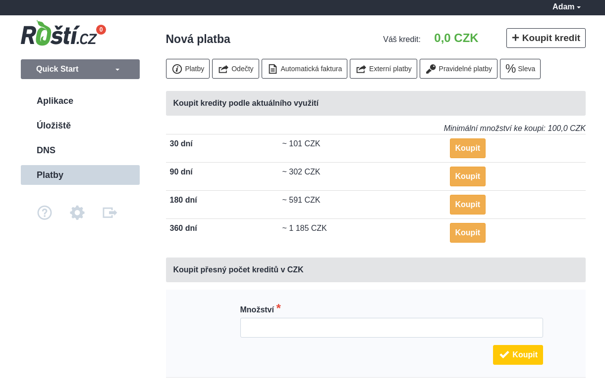

# Platby

!!! warning "Proč jsou Aplikace zastaralé"
    Aplikace jsou zastaralé. Pro nové projekty doporučujeme [Hosting - Stacky](stacks/quickstart.md). Stacky jsou modernější služba s AI-kompatibilním toolingem. Existující Aplikace zůstávají podporované.

## Zkušební období a čerpání kreditu

Po registraci máte 30 dní na vyzkoušení. Během této doby můžete aplikace a dostupné balíčky nastavit a používat stejně jako později. Větší balíčky jsou k dispozici až po připsání první platby. Po skončení zkušebního období není nutné přecházet na jiný tarif: u aktivních aplikací se začne podle jejich nastaveného balíčku čerpat kredit.

Roští používá předplacený kreditový systém, proto kredit dobijte před koncem zkušebního období. Systém vás na potřebu dobití upozorní.

Ceny balíčků uvedené za měsíc platí přesně pro 30 dní. U aktivní aplikace se každou hodinu odečte 1/720 ceny jejího balíčku. Za kalendářní měsíc s méně nebo více než 30 dny proto může být celková částka o něco nižší nebo vyšší než uvedená měsíční cena. Výše odpočtu závisí na aktivních aplikacích a jejich balíčcích, nikoli na jejich aktuálním zatížení.

Platí se za každou samostatnou aktivní aplikaci nebo stack. Balíček není společná kvóta pro všechny projekty ve firmě: dvě aplikace se stejným balíčkem se účtují dvakrát. Více projektů či domén můžete provozovat v jedné aplikaci, pokud se vejdou do jejích prostředků; postup popisuje [dokumentace pro více služeb v jedné aplikaci](multidomains.md).

Balíček aplikace můžete v jejích parametrech změnit kdykoli. Od okamžiku změny se kredit čerpá podle ceny nově zvoleného balíčku.

Pokud aplikaci nepotřebujete, je možné ji vypnout. Přestanete platit za běh aplikace, ale nadále se účtuje obsazený diskový prostor.

## Pravidelné platby

V sekci **Platby → Odhad nákladů** najdete odhad nákladů na Aplikace, Stacky, Pages a e-mailové schránky za 30 dní v měně firmy. U Stacků je rozepsaná cena profilu, disku navíc a snapshotů; u Aplikací je uveden i disk navíc. Pages používají měsíční sazbu poskytovanou službou.

Částky vycházejí z aktuálně dostupných sazeb a využití, jsou bez DPH a nezohledňují zkušební období ani bezplatný provoz na úrovni celé firmy. Skutečné odpočty se mohou při změně služeb nebo využití lišit. Pokud nelze načíst náklady některé služby, přehled zobrazí upozornění a dostupné položky; celkový odhad se v takovém případě nezobrazí.

Nedostupné části se nezobrazují jako nulové náklady. To platí i při neúplné historii využití sleepy stacku: dostupné služby zůstanou viditelné a tlačítkem **Zkusit znovu** lze odhad načíst znovu. REST API a MCP v takovém případě vracejí `total_amount: null` a seznam `unavailable_services`.

Stejný přehled je dostupný přes REST API (`GET /api-n/{company_id}/payments/regular-payments`) a MCP nástroj `get_regular_payments`. Pole `unavailable_services` označuje nedostupné části; při neúplných datech je `total_amount` rovno `null`.

## Dobití kreditu

Pro dobití kreditu přejděte do sekce *Platby* v administraci a vyberte časový interval spočítaný podle aktuální spotřeby kreditů nebo zadejte přímo částku, kterou chcete dobít. Minimální dobití je 100 Kč, což odpovídá 200 kreditům.

Částky pro jednotlivá období při nákupu kreditu zahrnují aktuální náklady na aplikace, stacky a Pages dané firmy. U stacků se započítává hodinová sazba serveru, dodatečného diskového prostoru i snapshotů; u Pages aktuální hodinová sazba služby. Hodinové sazby se přepočítají na denní náklady a vynásobí délkou období. Odhad předpokládá stejnou konfiguraci a využití úložiště po celé období a neodečítá stávající zůstatek peněženky. Stejný výpočet se používá také při nastavení automatické platby kartou.

Po odkliknutí je možné zaplatit přes QR kód, převodem na účet a po rozkliknutí zálohové faktury i kartou. Při vygenerování platby se vytvoří zálohová faktura, která neslouží jako daňový doklad. Ten vám bude zaslán automaticky po připsání částky na náš účet nebo na účet GoPay, která se nám stará o platby kartou.

Odhad zbývajícího kreditu vychází ze spotřeby aplikací, virtuálních serverů (stacků) a e-mailových schránek za předchozí den. Jednorázové platby za domény se do denní spotřeby pro tento odhad nezapočítávají. Při poklesu odhadu přibližně pod sedm dní obdržíte upozornění na potřebu dobití. Při vyčerpání kreditu vás systém upozorňuje denně; záporný zůstatek vyvolá upozornění i tehdy, když předchozí den nebyla žádná spotřeba. Po běžné lhůtě pro dobití následuje zamčení účtu a později jeho smazání, o kterých vás systém také informuje. Pokud ke smazání dojde, ozvěte se nám co nejdříve; obnovu dat negarantujeme a dostupnost záloh se řídí aktuálním zálohovacím cyklem uvedeným ve smluvních podmínkách.

V administraci je možné nastavit i automatické generování plateb pod záložkou *Automatická faktura*. Pokud ji zapnete, bude se dobíjet kredit na další nastavitelné období a to v případě, že klesne pod nastavenou hranici. Ta je ve výchozím stavu 50 Kč. Při využití této funkce musí být celkový kredit nad úrovní nastavené hranice. V opačném případě další automatická faktura nebude odeslána.

## Přehled odečtů

V sekci **Platby → Odečty** vyberte rok a měsíc. Roční přehled ukazuje celkové náklady a průměr za měsíce, ve kterých jsou evidované odečty. Právě probíhající měsíc obsahuje zatím zaúčtovanou spotřebu. Částky jsou v měně firmy, bez DPH, a zahrnují vrácený kredit.

Roky, souhrnné částky, měsíce, denní náklady a skupiny služeb jsou vizuálně oddělené. Sloupcové grafy umožňují porovnat roky, měsíce i jednotlivé dny; kliknutím na roční nebo měsíční sloupec vyberete období. Po najetí myší nebo zaměření klávesnicí se zobrazí částka. Denní graf zahrnuje i dny bez odečtů a vrácený kredit zobrazuje pod nulovou osou. Denní součty se počítají z kreditů před převodem do měny firmy a zaokrouhlením, aby se neztrácely malé hodinové odečty.

Po výběru měsíce uvidíte náklady podle služeb: stacky, aplikace, domény, schránky a ostatní služby. Kliknutím na skupinu zobrazíte měsíční náklady jednotlivých prostředků. U stacku jsou sloučené náklady za běh, disk navíc a snapshoty. Tlačítko **Zobrazit transakce** rozbalí původní denní položky. Historické identifikátory zůstávají dostupné i po smazání prostředku.

U nově zaznamenaných odečtů sleepy stacků je uveden účtovaný čas v hodinách, minutách a sekundách i celkový počet sekund, včetně případného účtovacího minima. Jde o účtovaný čas, nikoli skutečnou dobu běhu. Pro normální i sleepy stacky je zvlášť uvedena cena úložiště navíc a cena snapshotů; obě jsou již zahrnuté v celkové ceně stacku. Pokud jsou zaznamenané potřebné údaje, zobrazí se i úložiště navíc v GB·h. Nové odečty běžných stacků zaznamenávají tento údaj také, pokud je velikost úložiště známá. GB·h je součet velikosti úložiště navíc v GB násobené účtovanými hodinami, takže se správně zohlední změny velikosti během měsíce. Starší odečty mohou mít podrobnosti využití nedostupné nebo dostupné jen pro část období; současný stav stacku se nepoužívá k odhadování historické spotřeby. Náklady z historických diskových položek lze zobrazit i tehdy, když množství v GB·h nebylo zaznamenané.

Stejná data poskytuje REST API `GET /api-n/{company_id}/payments/subtractions/{year}/{month}` a MCP nástroj `get_payment_subtraction_detail`. Pole `groups` obsahuje skupiny služeb a jejich prostředky; původní transakce jsou stále v poli `items`. Pole `days` obsahuje denní součty jako `{date, credits, amount}`; záporná částka v tomto poli znamená čisté vrácení kreditu.

Vrácení kreditu za neúspěšnou registraci domény se v záložce **Odečty** zobrazí jako samostatná kladná částka s popisem vrácení kreditu. Původní odečet zůstává v historii označený **Kredit vrácen**. Měsíční součet zohledňuje vrácené částky; vrácení kreditu patří do měsíce, ve kterém bylo připsáno, i když registrace proběhla dříve.
